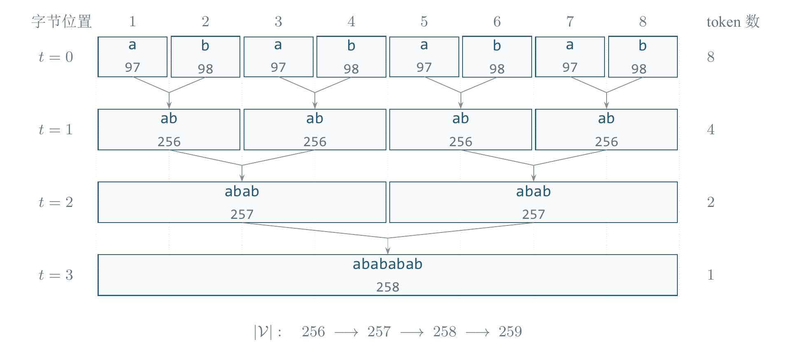

# Byte-Level BPE Analysis and Multilingual Sampling Design

**Reproducible research project in tokenizer analysis and multilingual experiment design**

A reproducible study of byte-level Byte Pair Encoding (BPE), source-level analysis of MinBPE, and a literature-informed design for selecting German/Spanish tokenizer-training data proportions. The repository combines executable examples, recorded checks, vector figures, and a Chinese technical report.

**Status:** the BPE examples, ordinary-text encoding comparisons, and sampling-quota calculations have been run. The German/Spanish corpus experiment is a proposed study, not a completed benchmark. No language model was trained.

[Project experience for agents](docs/PROJECT_EXPERIENCE.md) · [Structured experience record](experience/project.json) · [Read the PDF report](reports/tokenizer_analysis_report.pdf) · [Project scope](docs/PROJECT_SCOPE.md) · [Contribution and AI-use statement](docs/CONTRIBUTIONS.md) · [Proposed extensions](docs/EXTENSIONS.md)

## Research questions

- Explain how UTF-8 bytes become tokens through repeated pair merging, including overlapping pair counts and non-overlapping replacement.
- Relate the algorithm to a fixed, inspectable version of MinBPE, including merge ranks, regular-expression pre-tokenization, byte-ID remapping, and decoding.
- Compare the MinBPE `GPT4Tokenizer` wrapper with `tiktoken`'s `cl100k_base` on a small set of ordinary-text cases.
- Translate multilingual-tokenization literature into a controlled sampling experiment with explicit budgets, metrics, and limitations.

## Methods

The algorithm examples call the vendored MinBPE implementation and record each merge. A deliberately small `abababab` training example starts with 256 byte tokens and adds three merges. A separate counterexample demonstrates why inference uses learned merge priority rather than the frequency of pairs in the new input.

The encoding analysis examines eight input categories: English, German, Spanish, Chinese, digits, newlines, emoji, and the empty string. It checks token-ID equality against `cl100k_base` and full-text round trips. This establishes agreement on these cases; it does not establish equivalence for every possible input or special-token configuration. The wrapper loads an existing encoding rather than training GPT-4.

For multilingual sampling, the project calculates candidate shares using

$$q_l=\frac{n_l^\alpha}{\sum_j n_j^\alpha},\qquad 0\leq\alpha\leq1,$$

where `n_l` is the available text count for a language, measured in the same unit. The proposed corpus study fixes normalization, training-character budget, vocabulary size, data splits, and evaluation text. It evaluates each language separately against a 50:50 baseline. The hypothetical quota example uses Unicode code-point counts; it is not a corpus measurement.



*Executed controlled example: sequence lengths 8 → 4 → 2 → 1; vocabulary sizes 256 → 257 → 258 → 259. This is a tiny BasicTokenizer example, not the `cl100k_base` segmentation of this text.*

## Confirmed work and attribution

Repository-specific work delivered with AI assistance includes instrumented BPE examples, a merge-priority counterexample, encoding comparisons, a quota allocator, executable checks, source annotations, literature synthesis, and a LaTeX report with native TikZ/PGFPlots figures. These artifacts are distinct from the unchanged upstream algorithm implementation in `vendor/minbpe/`.

The project owner confirms that they handled this research project, including its scope and presentation requirements. The technical artifacts were developed with AI assistance, and upstream MinBPE remains separately attributed. [PROJECT_EXPERIENCE](docs/PROJECT_EXPERIENCE.md), [CONTRIBUTIONS](docs/CONTRIBUTIONS.md), and the structured experience record provide an evidence-based account for future CV review; personal identity fields are omitted.

## Findings and recorded results

| Item | Confirmed result | Evidence and scope |
| --- | --- | --- |
| BPE and encoding behavior | 17 checks passed | [verification.json](results/verification.json); this count includes grouped checks, not 17 independent datasets |
| Ordinary-text comparison | All 8 cases matched `cl100k_base` and round-tripped | [gpt4_check.json](results/gpt4_check.json); limited input coverage |
| Toy training trace | `abababab` encodes as `[258]`; unseen `ababab` as `[257, 256]` | [bpe_walkthrough.json](results/bpe_walkthrough.json); vocabulary size 259 |
| Overlap distinction | Second round: pair frequency 3, actual replacements 2 | Same controlled trace; `[256,256,256,256]` becomes `[257,257]` |
| Learned-priority counterexample | Rank-based and frequency-first encoding yield different IDs | [bpe_walkthrough.json](results/bpe_walkthrough.json); demonstrates an incorrect inference rule |
| Sampling arithmetic | 4 quota and boundary checks passed | [language_mix.json](results/language_mix.json); hypothetical inputs only |
| Reproducible figures | 3 native vector figures and 7 CSV/JSON data tables | [Figure manifest](figures/manifest.json); PDF plus 300 dpi PNG exports |

For the **assumed** German/Spanish inventory of 9 million/1 million characters and a 1 million-character budget:

| Sampling exponent | German share / quota | Spanish share / quota |
| --- | --- | --- |
| `0` | 50% / 500,000 | 50% / 500,000 |
| `0.5` | 75% / 750,000 | 25% / 250,000 |
| `1` | 90% / 900,000 | 10% / 100,000 |

These calculations do not identify an optimal language ratio. There are no reported downstream accuracy, perplexity, throughput, or real-corpus tokenization-quality gains.

The latest local checks of the reorganized repository are recorded in [repository_validation.json](results/repository_validation.json), including the commands actually run and the privacy/path checks. That local record is separate from any future GitHub Actions run; no hosted CI result is claimed.

To rerun the repository checks (local links, source/artifact hashes, explicit identity fields, machine paths, and PDF author metadata):

```sh
python -m pip install -r requirements-dev.txt
python code/validate_repository.py
```

The publication check excludes ignored caches/build files and cannot identify unknown personal information. The report and public project files contain no populated owner-name or private-identifier fields.

## Environment and dependencies

- Recorded algorithm runs: **Python 3.12.14 on Windows**, `regex==2026.9.29`, `tiktoken==0.14.0`.
- Installable Python dependencies are pinned in [requirements.txt](requirements.txt). Other Python versions and operating systems have not been validated here.
- The demonstrations need a CPU and no model API credentials or GPU.
- `tiktoken` may download its public `cl100k_base` encoding data on the first run. The local cache is excluded from version control; `TIKTOKEN_CACHE_DIR` can select a cache directory.
- Optional report build: **Tectonic**, with network access for uncached TeX packages. **Poppler** is needed only for PNG/SVG export. The report builder and figure-data exporter use the Python standard library. See [report build requirements](reports/requirements-report.txt).

## Run the examples

From the repository root, using an activated Python environment:

```sh
python -m pip install -r requirements.txt
python code/verify.py
python code/language_mix.py
python code/export_figure_data.py --verify-existing
```

`verify.py` reruns the BPE walkthrough and encoding comparison, then updates their JSON and Chinese text outputs in `results/`. `language_mix.py` updates the quota example. The figure-data command requires the seven existing data tables to match before writing them again.

To supply a different hypothetical inventory and budget:

```sh
python code/language_mix.py --de-chars 9000000 --es-chars 1000000 --total-chars 1000000
```

This command still calculates quotas only. It does not load a corpus or train a multilingual tokenizer.

## Rebuild the report and figures

The published PDF is ready to read; a TeX installation is only needed for rebuilding it.

```sh
python code/build_latex_report.py --check-only
python code/compile_report.py --png
```

If Tectonic is not on `PATH`, pass `--tectonic` with its executable path. PNG export is skipped with a message when `pdftoppm` is unavailable; PDF generation can still complete. The optional `--svg` flag requires `pdftocairo`.

The build reads editable content from `reports/content/`, generates `reports/latex/main.tex`, and writes the final [PDF report](reports/tokenizer_analysis_report.pdf). Edit the content JSON rather than the generated main file; edit diagram fragments directly in `reports/latex/figures/`. Rebuilding changes artifacts and requires another visual review. A successful compiler exit alone does not validate page layout.

## Repository layout

```text
code/                  Executable walkthroughs, checks, quota and report tools
docs/                  Detailed experience, scope, attribution, extensions and CV wording
experience/            Machine-readable project experience record
reports/
  tokenizer_analysis_report.pdf        Chinese technical report
  content/             Editable report content and AI-interaction record
  latex/               Generated TeX document and editable figure sources
results/               Recorded JSON results and Chinese text summaries
figures/               Vector PDFs, PNG previews, source data and manifest
vendor/
  minbpe/              Unmodified, pinned upstream implementation
  LICENSE              Upstream MinBPE MIT license
  provenance.json      Source commit and file hashes
requirements.txt       Pinned algorithm dependencies
```

Local caches, virtual environments, build intermediates, and machine-specific settings are excluded by `.gitignore`. The technical scope and evidence boundaries are summarized in [PROJECT_SCOPE](docs/PROJECT_SCOPE.md).

## Limitations and next experiments

This is a reproducible tokenizer-analysis study. The small input set is not a comprehensive correctness benchmark; tokenization efficiency is not a direct measure of language-model quality. No real German/Spanish corpus sweep, downstream model training, or optimal-ratio claim is included.

Three concrete, CPU-oriented extensions are specified in [EXTENSIONS](docs/EXTENSIONS.md): broader differential encoding checks, a small controlled language-ratio pilot, and a pre-tokenization ablation. All are **planned**, with no results attributed to them.

## References and third-party material

1. Andrej Karpathy, [MinBPE](https://github.com/karpathy/minbpe/tree/1acefe89412b20245db5a22d2a02001e547dc602), pinned at `1acefe89412b20245db5a22d2a02001e547dc602`. The vendored source retains its [MIT license](vendor/LICENSE); provenance and hashes are recorded separately.
2. OpenAI, [tiktoken](https://github.com/openai/tiktoken), used as the `cl100k_base` comparison implementation.
3. Zhang et al. (2022), [How Robust is Neural Machine Translation to Language Imbalance in Multilingual Tokenizer Training?](https://arxiv.org/abs/2204.14268). Its experiments do not establish an optimal German/Spanish ratio for this project.
4. Rust et al. (2021), [How Good is Your Tokenizer? On the Monolingual Performance of Multilingual Language Models](https://aclanthology.org/2021.acl-long.243/). Used to motivate per-language segmentation diagnostics.
5. Chung et al. (2023), [UniMax: Fairer and more Effective Language Sampling for Large-Scale Multilingual Pretraining](https://arxiv.org/abs/2304.09151). Used to motivate explicit sampling units, balance, and controls on repetition; its model-level results are not isolated tokenizer-ratio effects.

The upstream license applies to its covered files. A license for the repository-specific code and report has not been selected; see [NOTICE](NOTICE.md).
