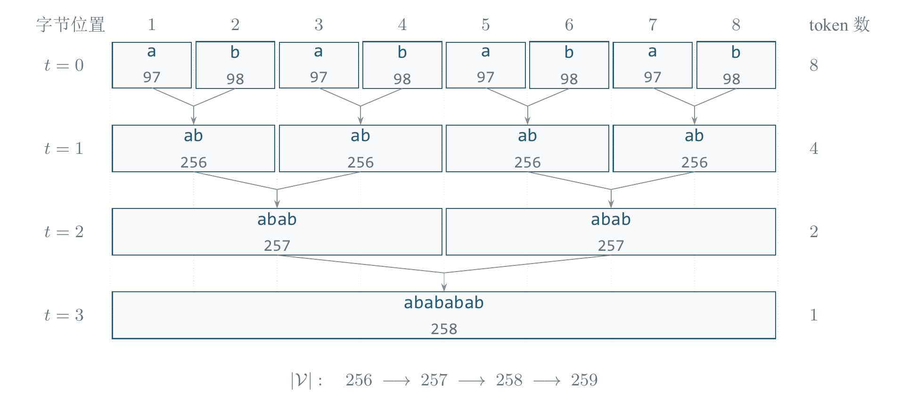
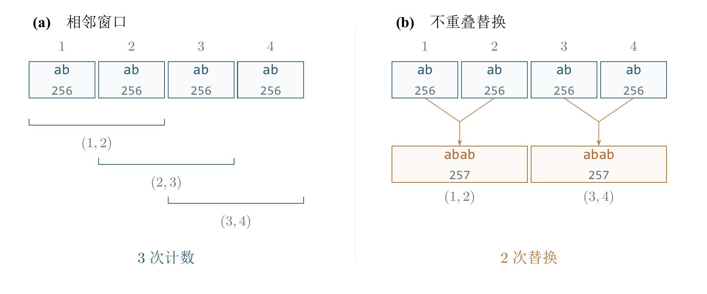
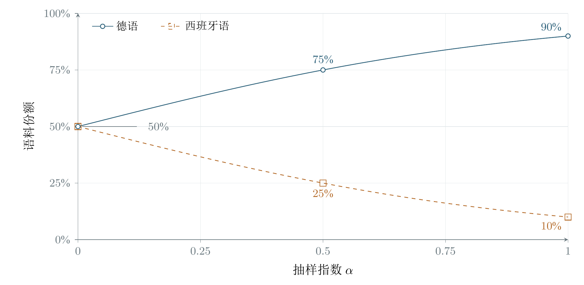

# 字节级 BPE 分析与多语言抽样设计

*Byte-Level BPE Analysis and Multilingual Sampling Design* · Technical Research Report

[在线查看 PDF 排印版](https://gofish040821.github.io/byte-bpe-multilingual-sampling/reports/tokenizer_analysis_report.pdf) · [项目主页](../README.md)

## 摘要

本文通过源码与运行记录，跟踪 MinBPE 如何学习和应用合并规则。训练 abababab 时，第一轮得到四个连续的 ab 词元。第二轮统计到三个相邻位置对，从左往右合并时每个词元只能用一次，因此执行两次替换。另一个例子说明，编码新文本时按训练得到的规则优先级合并。在选定的八个普通文本输入上，MinBPE 包装器与 cl100k\_base 逐个编号一致，解码均还原原文。验证程序的十七组行为检查全部通过。德语／西语部分在假设库存上完成了四项配额计算检查，并给出在真实语料上比较不同抽样比例的后续实验方案。

**关键词**　字节级 BPE；编码一致性；UTF-8；多语言抽样；可复现性。

[研究问题与分析框架](#part-1) · [编码验证结果与机制证据](#part-2) · [多语言分词器的语料抽样与评估设计](#part-3) · [附录 A　算法基础与源码审计补充材料](#part-4)

<a name="part-1"></a>

## 研究问题与分析框架

分词器将文本映射为离散编号，其合并规则、边界约束和训练语料分布共同决定输入序列的表示方式。准确分析这些环节，需要区分算法定义、具体实现和实证检查的证据范围。本项目以固定版本的 MinBPE 与 cl100k\_base 为对象，结合受控合并轨迹、源码审计和差分编码核对，建立能够逐项复查的机制证据；在此基础上，提出德语／西语分词器语料抽样的控制实验方案。

分析遵循三个层次：首先用规模有限、结果可完全追踪的输入检查 BPE 的局部操作；其次在不同文字与格式类型上比较已有编码的 token ID 和完整往返结果；最后把文献中的语言抽样思想转化为明确的计量单位、数据预算和语言内评价条件。三个层次对应不同的推断目标，不能仅凭前一层的检查通过，就宣布后一层的语言质量或模型能力得到改善。

### 研究问题与可检验命题

| 问题 | 操作性检查 | 证据能够回答的范围 |
| --- | --- | --- |
| RQ1：BPE 训练与编码中的选择依据有何不同？ | 跟踪相邻对频率、实际替换次数和已学合并优先级；构造两种选择规则产生不同编号的输入。 | 定位重叠计数与不重叠替换的差别，并检查新文本编码是否遵循既有规则。 |
| RQ2：具体编码包装器在什么范围内复现参考实现？ | 在固定编码、固定依赖和同一输入上比较完整 token ID 列表、字节拼接和文本往返。 | 确认所覆盖普通文本案例的一致性，识别正则边界、UTF-8 片段与字节编号映射的作用。 |
| RQ3：如何使多语言语料比例成为可评价的设计变量？ | 固定词表、字符预算、文本清洗与数据划分；先计算候选配额，再规定独立验证与测试指标。 | 给出可执行的比例选择程序；真实语料上的最优候选仍需按该程序测量。 |

对 RQ1，检验重点是可区分的行为命题：统计阶段允许相邻窗口共享位置，替换阶段按从左到右的不重叠配对消耗位置；训练时选择当前最高频相邻对，而编码时选择已学规则中优先级最高的可用合并。对 RQ2，判据采用精确编号相等与完整文本还原，而不是仅比较 token 总数。对 RQ3，判据首先要求比较条件一致，再讨论语言内序列长度的变化。

### 分析设计与证据来源

算法分析固定在 MinBPE 提交 1acefe89412b20245db5a22d2a02001e547dc602。上游文件保留原始实现、许可与哈希，项目中的跟踪和核对代码调用这些实现并保存中间状态。因此，可以将报告中的每个关键步骤追溯到具体函数、执行行和结构化结果，而不必依赖图形外观反推算法行为。

- 受控机制检查：训练微型词表，记录初始字节、每轮全部相邻对计数、所选规则、实际替换次数、词表内容与最终编号。将跟踪结果与 BasicTokenizer 的训练、编码及解码输出核对。
- 差分编码检查：分别初始化 MinBPE GPT4Tokenizer 与 tiktoken 的 cl100k\_base，对英文、德语、西班牙语、中文、数字、换行、Emoji 和空输入执行同一组核对。输入范围及逐 token 字节内容保存在结果文件中。
- 抽样设计检查：独立计算平滑语言份额与整数配额，并检查总预算约束、概率归一化和零库存边界。语料库存为明确标注的假设值；该部分的执行证据是配额运算，而非语料训练或性能评估。

| 记录单位 | 具体含义 | 解释约束 |
| --- | --- | --- |
| 相邻对频率／替换次数 | 前者计数所有相邻位置窗口，后者记录一次实际合并消耗的非重叠配对。 | 两个数值描述不同操作，存在重复元素时不能直接互换。 |
| token ID／UTF-8 字节 | ID 是编码词表中的索引，字节是该索引对应的原始内容。 | ID 数值本身不表示字符语义；一个 token 的字节可以不是完整字符。 |
| Unicode 码点／token 数 | 前者作为一致清洗规则下的文本预算单位，后者作为候选编码的输出长度。 | 语言比例以输入文本计量，避免因候选分词器改变而同时改变输入预算。 |
| 检查项／输入案例 | 检查项可包含多条断言；输入案例是一次具体的文本及其编码记录。 | 17 项行为检查与 8 类普通文本是不同计数，不视为独立数据集数量。 |

直接证据位于 results/bpe\_walkthrough.json、results/gpt4\_check.json、results/verification.json 和 results/language\_mix.json。图表数据、图源与文件哈希形成另一条核对链。正式结果章节呈现具体输入、编号和检查结论；源码审计附录补充实现细节与行号。

### 主要观察及机制解释

输入 abababab 在第一轮后变成四个 ab 词元，按从左到右编号为 1 至 4。第二轮统计时，第 1、2 个，第 2、3 个和第 3、4 个都构成相同的相邻对，共三个候选位置。替换时先合并第 1、2 个，第 2 个已经用过，接着合并第 3、4 个，得到两个 abab 词元。频次 3 计的是候选位置，替换次数 2 计的是本轮实际执行的合并。

合并优先级反例进一步把训练与推断区别转化为可检查的输出差异。同一新输入上，若错误地优先合并当前更高频的相邻对，会得到不同的编号序列。已有规则的先后顺序因而是编码规范的一部分，而不只是训练过程的记录。仅在新文本上重新统计频率，不能替代已训练的合并表。

编码对照中，八个给定输入的完整编号与参考编码逐项一致，拼接各 token 的字节后也能还原原文。结果章节列出全部输入，包括空字符串。检查还展示了两个实现细节：原始字节值与单字节 token ID 存在重排关系；某些 token 只含一个 UTF-8 字符的部分字节。

对多语言抽样，配额计算确认了平滑指数能够在库存比例与均衡份额之间生成可复算的候选设置。但配额正确只解决了输入分配问题，不能确定候选分词器在独立文本上的切分效率。后续评估需要固定语料质量、领域、词表和文本预算，再分别比较德语与西语相对同一基线的变化。相关论文用于支持这些控制条件与诊断思路，其原有任务范围和适用边界在多语言设计章节单独讨论。

### 复现与推断边界

现有算法轨迹和编码对照是确定性计算，复现对象由输入、固定源码、依赖版本和参考编码共同定义。保存中间序列与原始字节，使差异可以定位到具体步骤；保留完整结果而不只保存汇总数字，使后续扩展能够重复既有检查并记录新增覆盖范围。AI 辅助开发和审查记录与上游归属单独保留，以说明材料的产生过程。

当前证据支持所记录配置上的机制解释、有限输入的一致性和候选配额运算。输入覆盖仍然有限；普通文本一致性不自动包含所有特殊 token 配置，微型词表行为也不能直接外推为大型分词器的质量收益。真实德语／西语语料比例实验与下游语言模型评估属于尚待执行的研究设计。报告将这些层次分别呈现，使已执行验证与后续实证目标保持清楚对应。

<a name="part-2"></a>

## 编码验证结果与机制证据

以下结果来自仓库保留的实际运行记录，可用 code/verify.py 与 results 中的原始编号、字节和检查项核对。受控输入用于分析合并机制；普通文本用于比较两个编码实现。所有结果均针对所记录的配置与输入范围。

| 环境项 | 实际记录 |
| --- | --- |
| Python | 3.12.14 |
| regex / tiktoken | 2026.9.29 / 0.14.0 |
| MinBPE | 1acefe89412b20245db5a22d2a02001e547dc602 |
| 随机性 | BPE 示例与对照均为确定性计算，无随机种子 |

### 三轮合并与新文本编码



图 1  受控输入 abababab 的真实 BPE 合并轨迹。横向位置与块宽表示覆盖的原始字节；每轮把已有相邻 token 合成新 token。图中 token 数是当前文本的长度，词表大小则是可用编号的总数，两者不同。数据来源：results/bpe\_walkthrough.json。

| 轮次 | 选中相邻对 | 统计次数 | 实际替换 | 合并后的 ID |
| --- | --- | --- | --- | --- |
| 1 | `[97, 98]` | 4 | 4 | `[256, 256, 256, 256]` |
| 2 | `[256, 256]` | 3 | 2 | `[257, 257]` |
| 3 | `[257, 257]` | 1 | 1 | `[258]` |

第二轮开始时四个词元均为 ab（编号 256）。三个候选窗口分别覆盖位置 (1,2)、(2,3)、(3,4)。按从左到右的规则，替换 (1,2) 后直接到位置 3，再替换 (3,4)。三轮结束后，训练文本 abababab 编为 \[258\]；新文本 ababab 编为 \[257, 256\]，分别对应 abab 与 ab。两段文本均能解码还原。



图 2  同一序列的两个视角：get\_stats 检查所有相邻窗口，共计 3 个；merge 从左到右只替换不重叠的相邻对，共 2 次。因此日志中的出现次数不能直接当成实际替换次数。数据来源：上述实测记录的第 2 轮。

### 一个可以证伪错误理解的反例

用 ab1ab2ab3ab4bcbcbc 训练两次合并后，规则为 ab→256、bc→257。对新文本 abcbcbcbc，ab 只出现 1 次，bc 出现 4 次；正确编码仍先执行编号更小的 ab 规则。

```text
正确：[256, 99, 257, 257, 257]
错误地先按新文本频率合并 bc：[97, 257, 257, 257, 257]
```

这说明 encode 中虽然也调用 get\_stats，返回的出现次数却不是本轮选取依据；该函数还用于枚举当前有哪些相邻对。选择规则由 self.merges 中的已有优先级决定。

### 与 cl100k\_base 的普通文本对照

| 类别 | 输入（换行以转义表示） | token 数 | 编码／还原 |
| --- | --- | --- | --- |
| 英文 | 'Hello, world!' | 4 | 一致 / 成功 |
| 德语 | 'Füße, Straße und Häuser.' | 10 | 一致 / 成功 |
| 西班牙语 | '¡Hola! ¿Cómo estás? El niño come piña.' | 15 | 一致 / 成功 |
| 中文 | '你好，世界！' | 7 | 一致 / 成功 |
| 数字 | '1234567890' | 4 | 一致 / 成功 |
| 换行 | `'line one\n\nline two\n'` | 6 | 一致 / 成功 |
| Emoji | '🙂🚀' | 5 | 一致 / 成功 |
| 空字符串 | '' | 0 | 一致 / 成功 |

PDF 中 Emoji 用 Unicode 码点名称显示；真实字符、完整 ID 与字节数据保存在 results/gpt4\_check.json 和对应中文 TXT 中。

| 具体输入 | 真实 token ID |
| --- | --- |
| Hello, world! | `[9906, 11, 1917, 0]` |
| 你好，世界！ | `[57668, 53901, 3922, 3574, 244, 98220, 6447]` |
| 1234567890 | `[4513, 10961, 16474, 15]` |

中文例子中的“世”对应的 UTF-8 字节被拆在两个 token 中：ID 3574 对应 e4 b8，ID 244 对应 96。这两个 token 单独都不是完整字符；拼回字节后 e4 b8 96 才是“世”。因此，不应把每个 token 单独解码后出现的替换符当成分词错误。

数字 1234567890 先被正则分成 123、456、789、0，再在各块内部编码。字节编号也与 BasicTokenizer 不同：原始字节 97（a）对应 cl100k\_base 单字节 token ID 64；空格字节 32 对应 ID 220。这就是 GPT4Tokenizer 需要 byte\_shuffle 的原因。

### 检查范围与运行方法

code/verify.py 中的 17 组检查全部通过，覆盖重叠合并、尾部剩余、空输入、Unicode 完整往返、规则优先级、普通文本编码对照、编号重排和 GPT4Tokenizer 不可训练等行为。有限样例不能证明所有可能文本均正确，也未测试特殊 token 的完整往返。

```sh
python -m pip install -r requirements.txt
python code/verify.py
python code/language_mix.py
```

当前电脑也可以执行项目根目录的 run\_examples.ps1。无需 GPU 或模型 API；详细中文步骤见“使用说明.txt”。官方源文件、MIT 许可证、提交号及文件哈希都随项目保留。

<a name="part-3"></a>

## 多语言分词器的语料抽样与评估设计

我的方案是把语言比例看成需要验证的设计变量：先确定两种语言的使用需求，清洗并统计可用语料，再在相同词表大小和相同训练字符预算下比较若干比例。50:50 可以作为两种语言同等重要时的基线，但不能在实验之前称为最佳比例。本文完成的是文献核对和实验方案设计；尚未进行真实德语／西语语料的配比实验，也没有得到一个经实验证实的最优比例。

### 先明确：调的是分词器比例，不是大模型比例

BPE 训练是在决定“哪些相邻片段值得合并、有限的词表要记住哪些常见片段”。如果某种语言在训练材料中占比更高，它的片段往往更容易获得合并机会。因此，语言比例会影响两种语言的切分长度。词表也存在跨语言共享片段，所以不能简单认定“德语占 70% 的语料，就必然占 70% 的词表”。

| 要决定的比例 | 它影响什么 | 本项目如何处理 |
| --- | --- | --- |
| Tokenizer 训练语料比例 | BPE 合并规则与共享词表 | 本项目主要研究对象 |
| LLM 预训练语料比例 | 模型学习各语言的机会及能力 | 若做下游对照，应固定它，避免混淆 |
| 实际使用需求比例 | 系统服务哪些语言与任务 | 用于定义评价权重，不直接等同于前两者 |

例如，用户请求中有 70% 德语，不代表分词器必须用 70% 德语训练。德语是否已经能被高效切分、西语是否被切得过碎、语料是否覆盖真实业务，都需要一起考虑。反过来，分词器给两种语言相同训练份额，也不能保证大模型获得相同语言能力。

### 三篇论文提供了什么证据

\[R1\] Zhang 等（2022）直接研究 tokenizer 训练中的语言不平衡。他们固定模型训练设置，改变分词器语料比例；在其机器翻译实验中，更均衡的比例往往较好，但性能对比例失衡也比直觉预期更稳健。他们强调，tokenizer 抽样与模型训练抽样需要分别研究。主要实验采用 SentencePiece Unigram，并以 BPE 做消融。研究是英语中心、最多涉及八种语言，未直接测试德语／西语组合，因此不能把结论写成“德西 1:1 已被证明最优”。

\[R1\] Zhang et al. (2022). How Robust is Neural Machine Translation to Language Imbalance in Multilingual Tokenizer Training? 重点：§3.1、§3.4、§4、§6。 [原文](https://arxiv.org/html/2204.14268v2)

\[R2\] Rust 等（2021）比较多语言与单语言模型，发现语言在词表中是否得到充分表示，与下游表现有关。他们使用 fertility（每个词平均切成多少个子词）和被拆分词的比例描述切分程度。这支持“逐语言检查是否过度切分”，但不支持“token 越少，模型必然越好”，也没有直接给出德语／西语应采用的采样比例。

\[R2\] Rust et al. (2021). How Good is Your Tokenizer? On the Monolingual Performance of Multilingual Language Models. 重点：§4.2、§4.3 与相关性分析。 [原文](https://aclanthology.org/2021.acl-long.243/)

\[R3\] Chung 等（2023）的 UniMax 尽量均匀分配语言预算，同时限制小语种语料重复次数。论文还为不同采样策略分别训练词表，并以字符数衡量各语言语料规模。可借鉴的是“均衡、避免过度重复、先定义计量单位”。它研究的是多语言预训练整体设置，其性能提升不能全部归因于 tokenizer 比例，也不能直接当作 byte-level BPE 的最佳配比结论。

\[R3\] Chung et al. (2023). UniMax: Fairer and more Effective Language Sampling for Large-Scale Multilingual Pretraining. 重点：§3、§3.1、§4.2。 [原文](https://arxiv.org/html/2304.09151v1)

| 证据层次 | 本文采用的内容 | 不能越过的边界 |
| --- | --- | --- |
| 文献直接支持 | 在原论文的语言、模型和任务范围内，分词质量与表现有关；抽样阶段需要区分 | 不推广成所有 LLM、所有语言对的必然规律 |
| 可迁移、尚待德西验证 | 参考平滑抽样、字符计量、重复限制与逐语言切分诊断 | 应重新在真实德语／西语文本上检验 |
| 本报告自己的建议 | 候选配比、5 百万字符、8,192 词表、三种子与 5% 门槛 | 是实验设计选择，不是论文给出的最优配置 |

### 收集语料时，比例前面还有三个条件

- 内容质量：先检查语言标签，去掉乱码、模板、广告、重复或近重复文档。误标为西语的英文网页，不能算成有效西语训练材料。
- 领域覆盖：两种语言分别覆盖目标任务需要的领域，例如通用文本、技术说明与对话。若一边全是新闻、另一边全是代码，比较出的差异同时包含语言与领域差异。
- 计量单位：本文将比例定义为清洗后 Unicode 字符数占比，并固定正规化方式；不能混用文档数、字节数、词数和 token 数。

具体可统一采用 NFC 正规化，并按 Unicode 码点计数，空格和标点也计入；训练、验证与测试使用完全一致的规则。这是一个可复现的工程口径，不表示字符数能完整衡量语义信息。文档长短不同，所以“各取 100 篇”不等于材料数量相同；UTF-8 中带重音字符可能占多个字节，所以字节占比也不等于字符占比。不要用正在比较的 tokenizer 输出 token 数反过来定义输入份额，否则比较口径会随候选方案改变。

德语与西语共享不少字母和标点，但仍应保留并检查各自常见的特殊字符、词形变化与长词。建议人工查看如德语复合词，以及西语带重音或变位的词，确认常见内容没有异常碎裂。这些是诊断样例，不应仅靠几个手选单词决定整个比例。

### 用平滑抽样生成候选比例

设 n\_l 是语言 l 清洗后可用的字符数。可先用下面的指数平滑规则产生候选份额 q\_l。α 是需要尝试的参数，不是从论文复制后就永远适用的常数；这里仅考虑 n\_l 大于零的语言。

```math
q_l=\frac{n_l^{\alpha}}{\displaystyle\sum_j n_j^{\alpha}},\qquad 0\leq\alpha\leq1.
```



图 3  假设清洗后德语与西语的库存字符数为 9:1，指数平滑参数 α 如何改变训练份额。曲线由公式精确计算，标记点与 language\_mix.py 的配额结果一致。这是数学情景，不是语料采集结果或模型性能曲线，也不能据此确定最佳 α。完整点数据见 figures/language\_sampling.csv。

| α | 直观含义 | 假设原始德语:西语=9:1 时 |
| --- | --- | --- |
| 1 | 保持清洗后的原始份额 | 9:1，即 90%:10% |
| 0.5 | 减小大语种的优势 | √9:√1=3:1，即 75%:25% |
| 0 | 在语料非空的语言间均匀分配 | 1:1，即 50%:50% |

附带的 code/language\_mix.py 已实际计算这个数学例子：假设德语有 900 万字符、西语有 100 万字符，训练预算为 100 万字符，α=0、0.5、1 对应的德语／西语配额分别为 50 万／50 万、75 万／25 万、90 万／10 万。配额总和、份额总和、平方根平滑与零库存边界共 4 项检查通过。输入数量是假设值；程序没有训练或评估德语／西语分词器，完整输出在 results/language\_mix.json。

表中的 9:1 只是数学例子，不是本次收集到的真实语料统计。指数越小，分配越均匀。这个规则帮助系统地提出候选，但不能表达所有业务偏好；还可以直接比较 30:70、50:50、70:30 等比例。若预计主要服务德语，应在报告中事先说明评价权重，同时保留西语的最低质量要求，而不是在看到结果后挑一个对自己有利的权重。

提高某语言的相对份额不一定需要重复文本：可以减少另一语言的抽样量。本文的 tokenizer 先导实验优先不放回抽样，即同一文档最多使用一次。若某个候选比例需要的唯一语料超过库存，应补充语料、对所有候选统一降低总预算，或明确标记该候选不可行；不能静默复制少量文本来凑比例。若另做带重复上限的方案，应记录上限、实际重复量及与无重复方案的差别。这是借鉴 UniMax 的控制思想，而不是声称复现其全部算法。

### 我提出的可复现实验方案（尚未执行）

先做只训练 tokenizer 的低成本筛选，再决定是否值得训练下游模型。下面数值是可执行的先导配置，可按唯一语料量与计算资源统一缩小；它们不是经验最优参数。更换预算或词表大小后，应重跑全部候选。实现时使用能够承受该规模的 BPE 训练器；机制分析用 MinBPE 的速度不能代表生产训练器。

| 项目 | 预先固定的设置 |
| --- | --- |
| 数据划分 | 按完整文档或来源先去重，再划分训练／验证／测试；三者不共享重复或近重复内容 |
| Tokenizer 家族 | 同一种 byte-level BPE、同一预切分规则、NFC 规则与特殊 token 策略 |
| 训练预算 | 每个候选共 5,000,000 个字符；不足时统一降低所有候选的预算 |
| 词表大小 | 8,192 个普通 token，包含 256 个基础字节；特殊 token 如需使用则另外固定 |
| 候选德语:西语份额 | 10:90、30:70、50:50、70:30、90:10；另加入实际库存的 α=0.5 候选，重复项合并 |
| 验证／测试 | 两种语言分别留出 200,000 字符验证集和 200,000 字符最终测试集；不足则统一缩小并报告 |
| 抽样重复 | 每个候选用 3 个预先固定的随机种子独立抽样；记录种子、语料来源、哈希与实际份额 |

先按语言与领域分层，再按字符预算抽取完整文档，避免一个比例恰好抽到更多简单文本。完整文档长度可能让最终份额偏离目标，应设置小的预算容差并报告实际字符数与份额。如果必须截取片段，应先将文件解码成 Unicode 文本，再按完整文本边界截取；不能在原始 UTF-8 字节流中直接切到指定长度，否则可能把一个字符切坏。公平比较要求固定输入字符预算，而不是固定候选 tokenizer 各自产生的 token 数。不同候选的输出 token 数本来就是要测量的结果。

验证集用于比较候选、选比例；测试集在方案确定后才用于最终报告。即使所有数据都来自公开网页，也不能把训练集上的压缩效果写成泛化效果。随机种子的重复用于观察语料抽样带来的波动，不代表训练了三个大语言模型。

### 用什么指标决定保留哪个比例

```math
T_l=\frac{\#\,\mathrm{tokens}_l}{\#\,\mathrm{characters}_l}.
```

T\_l 表示平均每个字符需要多少 token。在同一语言、同一份验证文本上，T\_l 较低说明切分更紧凑。例：同一段 1,000 字符的文本被候选 A 切为 400 tokens，候选 B 切为 500 tokens，则 T 分别是 0.40 与 0.50。这只是指标计算例子，不是实际测量。具体计算时，逐个编码正规化后的非空文档，分子累加普通文本 token 数，分母累加这些相同文本的 Unicode 字符数，包含空格与标点，不额外插入特殊 token。不要先把文档拼接得可跨文档合并。本文使用总数之比，与逐句比率再平均不同，应在实现与报告中保持一致。

| 指标／检查 | 作用 | 解释边界 |
| --- | --- | --- |
| 逐语言 tokens / character | 比较同一语言在各候选下的序列长度 | 跨语言不能直接当成能力或公平分数 |
| Fertility：每词平均子词数 | 观察词被拆分的程度；需固定词边界规则 | 德语长复合词与西语词形不同，不能要求两语数值相等 |
| 长文 token 长度的 P95 | 观察较长输入的上下文压力 | 需固定文档集合；P95 是 95% 文档不超过的长度 |
| 编码再解码一致性 | 确认规范化后的文本可完整还原 | 完整字节覆盖通常无 UNK，但不等于切分高效 |
| 常见词、专名、数字和混合语言样例 | 发现平均指标掩盖的局部异常 | 用于诊断，不替代独立验证集 |

Fertility 只作为辅助指标。为了让实现明确，可以先按空白和标点切出词，并在所有候选上使用同一规则，对词分别分词，计算每词 token 数；应说明这是一种操作性定义，与整段文本编码可能不同。如果改用语言学词边界标注，则两种语言分别使用固定标准，并注明来源。最有意义的比较是“同一语言在新方案相对基线改善多少”，而不是直接比较德语和西语谁的 fertility 更低。

若两种语言同等重要，可以先以 50:50 为基线，再比较各语言 T 相对基线的变化。一个明确的选择规则是：先排除任一语言相对基线恶化超过预设容忍度的候选，再在剩余候选中选加权平均相对长度最小者。容忍度和权重属于项目要求，必须在看结果之前写下；例如先导阶段可暂设每语不恶化超过 5%，两语各占一半权重，再做敏感性检查。这里的 5% 是提议的工程门槛，不是论文结论。

```math
\begin{aligned}
R_l(q)&=\frac{T_l(q)}{T_l(0.5)},\\[4pt]
J(q)&=w_{\mathrm{de}}R_{\mathrm{de}}(q)+w_{\mathrm{es}}R_{\mathrm{es}}(q),\qquad w_{\mathrm{de}}+w_{\mathrm{es}}=1.
\end{aligned}
```

报告每个候选的三次抽样均值和范围。若差异小于抽样波动，不应宣称某个比例明显更优；可保留几个折中候选。tokenizer 筛选完成后，若预算允许，再用相同模型架构、固定 LM 语言采样分布和预先约定的训练计算预算，对少数候选做下游验证。不同词表的每 token 困惑度不能直接横比，可使用同一原文上的按字节或字符归一化损失，并辅以德语／西语目标任务评价。

### 最终观点与适用范围

我会从清洗后的库存比例、均匀比例和若干中间比例出发，用独立文本验证各语言的切分效率，在明确的业务权重与逐语言质量约束下选取比例；随后用下游任务检查这项选择是否真正有益。若暂时没有实验资源，我只把 50:50 作为双语同等重要时的合理起点，并保留“需要验证”的结论。

这套方案的局限是：字符预算并不等同于语义信息量；德语与西语的领域和词形差异可能影响指标；小规模词表实验不能直接外推到大规模模型；切分更紧凑只降低序列长度，不能独自证明理解与生成能力提高。文献也没有给出适用于所有德语／西语 LLM 的固定最佳比例。因此，本项目提出“有证据、有控制变量、有评价标准的选择方法”，不能用一个未经验证的数字代替论证。

<a name="part-4"></a>

## 附录 A　算法基础与源码审计补充材料

本节分析 BPE 的规则学习与编码机制，并将每个关键步骤对应到固定版本 MinBPE 的 Python 函数及代码行号。通过可手算的输入观察相邻对统计、合并优先级和 UTF-8 字节处理，再检查 cl100k\_base 编码包装器的实现边界。

BPE 的核心做法是：先把文字拆成很小的单位，反复寻找最常一起出现的相邻两块，把它们合成一个新单位。训练结束后，这些合并规则固定下来。之后处理新文字时，分词器照着已有规则合并，不会重新学习一套词表。MinBPE 采用字节级 BPE，最小单位是 UTF-8 字节，而不是汉字或完整英文单词。

| 名词 | 先这样理解 |
| --- | --- |
| token | 模型处理文字的一个单位；可能是单个字节、一个字的一部分、几个字母、单词或其他片段，并不等于“单词”。 |
| token ID | 这个单位的整数编号。编号是查表用的标签，数值大小本身不表示词义。 |
| 字节（byte） | 计算机保存数据的基本单位之一，一个字节的数值在 0 到 255 之间。 |
| UTF-8 | 把文字转换成字节序列的一种规则。英文 a 只需一个字节，汉字通常需要多个字节。 |
| vocab（词表） | 在本仓库中主要指“token ID → 对应字节串”的表，用于恢复文本。 |
| merges（合并表） | “两个相邻 token 的编号 → 新 token 编号”的表。 |
| train / encode / decode | 分别是学习合并规则、将文字变成编号、将编号恢复为文字。不要把三者混为一谈。 |

### 先手算一遍：abababab 如何被压缩成一个 token

下面是教学手算，不是某个真实 GPT-4 输出。为便于看清过程，只用英文 a 和 b，并按 BasicTokenizer 的实现设定 vocab\_size=259。初始 256 个 token 对应所有可能的单字节；a 的字节值是 97，b 的字节值是 98。目标词表大小为 259，所以要学习 259−256=3 条合并规则。

| 阶段 | 当前序列 | 统计与选择 | 合并结果 |
| --- | --- | --- | --- |
| 开始 | `[97,98,97,98,97,98,97,98]` | (97,98) 出现 4 次；(98,97) 出现 3 次。选择 (97,98)，新编号 256。 | `[256,256,256,256]` |
| 第 2 轮 | `[256,256,256,256]` | 相邻窗口中的 (256,256) 共 3 次；把它定为新编号 257。 | `[257,257]` |
| 第 3 轮 | `[257,257]` | (257,257) 出现 1 次；把它定为新编号 258。 | `[258]` |

第 2 轮最容易看错：四个 256 之间有三个相邻窗口，所以统计次数是 3；但真正替换时，一个位置不能被两个合并同时使用。程序从左向右先合并第 1、2 个，再合并第 3、4 个，因此只发生 2 次替换。相邻对的统计允许重叠，实际替换采用不重叠配对；二者不必相等。

| 新 token ID | 合并规则 | 对应的实际字节内容 |
| --- | --- | --- |
| 256 | (97,98) → 256 | ab |
| 257 | (256,256) → 257 | abab |
| 258 | (257,257) → 258 | abababab |

训练后，词表仍保留原来的 256 个单字节 token，并增加这 3 个新 token。不是把 a、b 删除了。输入另一个字符串 ababab 时，按已有规则可先得到 \[256,256,256\]，再得到 \[257,256\]；最终分别代表 abab 和 ab。训练没有学过 (257,256) 的合并规则，所以不能继续把它合成一个 token。

下面是附带 code/bpe\_walkthrough.py 中的核心调用方式。完整脚本已配置 vendor 源码的导入路径，直接运行该脚本即可。这里只训练一个很小的 BasicTokenizer；编号由该微型词表决定。手算已与实际程序结果核对，完整运行记录见后文。

```python
from minbpe import BasicTokenizer

tokenizer = BasicTokenizer()
tokenizer.train("abababab", vocab_size=259, verbose=True)
print(tokenizer.encode("abababab"))  # 手算预期：[258]
print(tokenizer.encode("ababab"))    # 手算预期：[257, 256]
print(tokenizer.decode([257, 256]))  # 手算预期：ababab
```

#### 再看中文：“你好”为什么从 6 个字节开始

英文例子中，一个字母恰好只占一个字节；中文不能照搬这种对应关系。Python 中“你好”有两个 Unicode 字符，却会被 UTF-8 编码成六个字节。

| 文字 | UTF-8 字节值 | 字节数 |
| --- | --- | --- |
| 你 | 228, 189, 160 | 3 |
| 好 | 229, 165, 189 | 3 |
| 你好 | 228, 189, 160, 229, 165, 189 | 6 |

只用 abababab 训练的微型分词器没有学过这些中文片段的合并，所以“你好”会保留为 6 个初始 token。解码时把这些字节完整接起来，再按 UTF-8 还原，仍能得到“你好”。有更多中文训练材料的分词器可以学到不同的合并，因此不能据此断言所有模型都把“你好”切成 6 个 token。实际程序已核对这组字节和完整往返。

#### Python 语法与实现约定

| 写法 | 本项目中的意思 |
| --- | --- |
| self | 当前这个分词器对象。self.merges 表示这个对象保存的合并表。 |
| class A(B) | 定义一种 A 对象，它继承 B 已有的功能；A 还可以补充或改写功能。 |
| \_\_init\_\_ / super().\_\_init\_\_() | 创建对象时执行的初始化方法；super() 用来调用父类版本，先建立公共状态。 |
| 字典 d\[key\] 与 d.get(key, default) | 前者直接查一个键；后者在键不存在时返回 default。这里常用默认值 0 或正无穷。 |
| `zip(ids, ids[1:])` | 把原列表与“去掉第一个元素后的列表”并排配对，得到每一对相邻编号。 |
| max(stats, key=stats.get) | 遍历字典里的键，按各键对应的统计次数比较，选次数最大的那一对。不是选数值最大的 token ID。 |
| lambda p: ... | 临时写一个短函数；这里规定比较相邻对 p 时应该看它的合并顺序。 |
| min(..., key=...) | 按 key 指定的标准找最小项。编码时用它选最早学到、优先级最高的可用合并。 |
| bytes(\[97,98\]) 与 \[97,98\] | 前者是字节串 b'ab'；后者是整数列表。内容可以对应，但它们是不同类型。 |
| 列表推导式 \[f(x) for x in xs\] | 依次对 xs 中的每个元素执行 f(x)，收集为新列表。 |
| append 与 extend | append 把一个对象加到末尾；extend 把另一个列表中的各个元素依次接到末尾。 |
| return、break、continue | 分别是返回函数结果、结束当前循环、跳过本轮并进入下一轮。 |

理解下面四个文件的分工即可：base.py 提供公共工具；basic.py 展示最简训练和编码；regex.py 在它的思路上增加正则预切分与特殊 token；gpt4.py 读取已有的 cl100k\_base 规则，并处理其编号细节。代码段中的空行和英文说明不执行；配注重点逐一解释每条实际执行语句。所有行号均按本报告固定的 MinBPE 提交。

### base.py：get\_stats 统计相邻对，13–22 行

[minbpe/base.py · 第 13–22 行](../vendor/minbpe/base.py#L13-L22)

```text
 13  def get_stats(ids, counts=None):
 19      counts = {} if counts is None else counts
 20      for pair in zip(ids, ids[1:]): # iterate consecutive elements
 21          counts[pair] = counts.get(pair, 0) + 1
 22      return counts
```

| 行号 | 逐行解释 |
| --- | --- |
| 13 | 定义统计函数。ids 是整数列表；counts 可传入已有统计表，默认不传。 |
| 19 | 没传 counts 就新建空字典；传了就继续使用同一个字典，保留已有计数。 |
| 20 | ids\[1:\] 从第 2 个元素开始；zip 将它与原列表配成相邻对，循环逐对处理。 |
| 21 | 读出 pair 原有次数；不存在时按 0 处理，再加 1 并存回字典。 |
| 22 | 返回统计字典。传入已有字典时，原字典也已经被直接更新。 |

例如 ids=\[97,98,97\]：zip 的结果是 (97,98)、(98,97)。对 \[256,256,256,256\]，结果是三个相同的 (256,256)，因此计数为 3。这里没有做任何合并，也没有决定新 token 编号。它只负责回答“每一种相邻对出现了多少次”。

#### base.py：merge 从左向右替换一类相邻对，25–41 行

[minbpe/base.py · 第 25–41 行](../vendor/minbpe/base.py#L25-L41)

```text
 25  def merge(ids, pair, idx):
 31      newids = []
 32      i = 0
 33      while i < len(ids):
 35          if ids[i] == pair[0] and i < len(ids) - 1 and ids[i+1] == pair[1]:
 36              newids.append(idx)
 37              i += 2
 38          else:
 39              newids.append(ids[i])
 40              i += 1
 41      return newids
```

| 行号 | 逐行解释 |
| --- | --- |
| 25 | 定义替换函数：ids 是原序列，pair 是要合并的两个编号，idx 是合并后的新编号。 |
| 31 | 建立空列表，用来收集合并后的结果。 |
| 32 | 从原序列的第 0 个位置开始检查。Python 下标从 0 开始。 |
| 33 | 只要还没走到原序列末尾，就继续处理。 |
| 35 | 检查当前编号、右侧位置是否存在、右侧编号是否匹配。and 从左向右短路求值，边界检查通过后才访问 ids\[i+1\]。 |
| 36 | 匹配成功，把新 token 编号追加到结果。 |
| 37 | 原来的两个位置都已使用，指针向右走 2 格，避免重叠替换。 |
| 38 | 如果相邻对不匹配，进入此分支。 |
| 39 | 把当前这个原编号原样保留到结果中。 |
| 40 | 只处理了一个位置，因此指针向右走 1 格。 |
| 41 | 返回新列表。函数没有直接改写传入的原列表。 |

这个函数不统计频次，也不比较不同规则的优先级；它只执行调用者已经选好的那条规则。训练和编码都会使用它，但“如何选 pair”由外层代码决定。函数内使用新列表，所以外层通常写 ids=merge(...)，让 ids 指向新的结果。

### basic.py：创建最简单的分词器，15–18 行

[minbpe/basic.py · 第 15–18 行](../vendor/minbpe/basic.py#L15-L18)

```text
 15  class BasicTokenizer(Tokenizer):
 17      def __init__(self):
 18          super().__init__()
```

| 行号 | 逐行解释 |
| --- | --- |
| 15 | 定义 BasicTokenizer，它继承公共 Tokenizer 类。 |
| 17 | 定义创建该对象时调用的初始化方法。 |
| 18 | 执行父类初始化，建立空合并表、初始词表等公共状态。 |

父类的初始词表含 256 个单字节 token。BasicTokenizer 不做正则预切分，也不专门识别特殊 token；整个输入的字节序列直接进入 BPE。因此它适合先理解核心算法，但不能仅凭它声称已经复现 GPT-4 分词。

#### basic.py：train 学习合并规则，20–49 行

[minbpe/basic.py · 第 20–49 行](../vendor/minbpe/basic.py#L20-L49)

```text
 20      def train(self, text, vocab_size, verbose=False):
 21          assert vocab_size >= 256
 22          num_merges = vocab_size - 256
 25          text_bytes = text.encode("utf-8") # raw bytes
 26          ids = list(text_bytes) # list of integers in range 0..255
 29          merges = {} # (int, int) -> int
 30          vocab = {idx: bytes([idx]) for idx in range(256)} # int -> bytes
 31          for i in range(num_merges):
 33              stats = get_stats(ids)
 35              pair = max(stats, key=stats.get)
 37              idx = 256 + i
 39              ids = merge(ids, pair, idx)
 41              merges[pair] = idx
 42              vocab[idx] = vocab[pair[0]] + vocab[pair[1]]
 44              if verbose:
 45                  print(f"merge {i+1}/{num_merges}: {pair} -> {idx} ({vocab[idx]}) had {stats[pair]} occurrences")
 48          self.merges = merges # used in encode()
 49          self.vocab = vocab   # used in decode()
```

| 行号 | 逐行解释 |
| --- | --- |
| 20 | 定义训练方法。text 是训练文本；vocab\_size 是目标词表大小；verbose 控制是否打印过程。 |
| 21 | 要求词表至少容纳 256 个初始字节 token，否则断言失败。 |
| 22 | 每次合并新增一个 token，所以训练轮数等于目标大小减去 256。 |
| 25 | 按 UTF-8 规则把 Python 字符串转换为字节串。这里的 encode 是字符串方法，不是分词器的 encode 方法。 |
| 26 | 把字节串转换成整数列表，初始每项都在 0–255 之间。 |
| 29 | 新建合并表，记录“两个旧编号 → 一个新编号”。 |
| 30 | 建立初始词表：每个 0–255 的编号对应一个单字节串。 |
| 31 | 按预定次数循环；i 从 0 开始，每轮产生一个新 token。 |
| 33 | 对当前 ids 统计所有相邻对的频次。每轮都重新统计，因为序列已经改变。 |
| 35 | 按 stats 中的计数选最大的 pair。若并列，这段代码采用字典遍历中先遇到者。 |
| 37 | 新编号从 256 起，随后依次为 257、258……；它也记录规则产生的先后顺序。 |
| 39 | 将当前序列中可从左到右配对的 pair 替换为 idx，并更新 ids。 |
| 41 | 把新规则写入合并表，供以后编码新文本时使用。 |
| 42 | 把两个旧 token 对应的字节串相接，得到新 token 的实际字节内容。这里的 + 是拼接字节串。 |
| 44 | 只有 verbose 为真时，才执行下一行打印。 |
| 45 | 打印轮次、合并对、新编号、字节内容和相邻窗口计数；最后这个计数不一定等于实际替换次数。 |
| 48 | 把学到的合并表交给当前分词器，后续 encode 会读取它。 |
| 49 | 把完整词表交给当前分词器，后续 decode 会读取它。 |

这里的“训练”没有神经网络反向传播，只是反复统计与合并。代码也没有在相邻对耗尽时自动提前结束：如果文本太短而目标词表设得过大，stats 可能为空，max 会失败。因此小例子只设 259，而不是直接要求训练出几万个 token。实际实验应准备足够语料，并检查停止条件。

#### basic.py：decode 把编号还原成文字，51–55 行

[minbpe/basic.py · 第 51–55 行](../vendor/minbpe/basic.py#L51-L55)

```text
 51      def decode(self, ids):
 53          text_bytes = b"".join(self.vocab[idx] for idx in ids)
 54          text = text_bytes.decode("utf-8", errors="replace")
 55          return text
```

| 行号 | 逐行解释 |
| --- | --- |
| 51 | 定义解码方法，输入是一串 token ID。 |
| 53 | 依次按编号查词表，取出各 token 的字节内容，用空字节串连接成完整字节序列。 |
| 54 | 将完整字节序列按 UTF-8 还原为文字；非法字节序列用替代字符表示。 |
| 55 | 返回还原后的字符串。 |

必须先拼接字节，再解码成文字。原因是一个 token 可能只保存某个汉字 UTF-8 编码的一部分，单独解码它未必合法。对合法文本正常 encode 后再 decode，通常可以恢复原文；任意拼凑 token ID、截断序列或输入无效字节，则不保证仍是合法文字。未知 ID 查词表也会出错。

#### basic.py：encode 用固定规则处理新文本，57–74 行

[minbpe/basic.py · 第 57–74 行](../vendor/minbpe/basic.py#L57-L74)

```text
 57      def encode(self, text):
 59          text_bytes = text.encode("utf-8") # raw bytes
 60          ids = list(text_bytes) # list of integers in range 0..255
 61          while len(ids) >= 2:
 63              stats = get_stats(ids)
 64              pair = min(stats, key=lambda p: self.merges.get(p, float("inf")))
 69              if pair not in self.merges:
 70                  break # nothing else can be merged anymore
 72              idx = self.merges[pair]
 73              ids = merge(ids, pair, idx)
 74          return ids
```

| 行号 | 逐行解释 |
| --- | --- |
| 57 | 定义编码方法：输入普通字符串，返回 token ID 列表。 |
| 59 | 先将文本转换为 UTF-8 字节串。 |
| 60 | 再把每个字节转换为 0–255 的初始整数编号。 |
| 61 | 至少有两个编号时才可能合并；只有 0 或 1 个时直接结束循环。 |
| 63 | 列出当前序列中出现的相邻对；此处虽然也计算次数，但下一行不使用次数作决策。 |
| 64 | 对每个相邻对 p 查已学合并编号，选编号最小者；没学过的 pair 记为正无穷，使其排在可用规则之后。 |
| 69 | 若选中的相邻对不在合并表，说明当前所有相邻对都没有可用合并规则。 |
| 70 | 结束循环，不再继续合并。 |
| 72 | 读取这条既有规则对应的新 token 编号。 |
| 73 | 执行不重叠替换，得到下一轮的序列。这里不创建新规则。 |
| 74 | 返回最终 token ID 列表。 |

训练阶段按“当前出现最多”来创造规则；编码阶段按“已有规则中最早学到”来应用规则。例如假设已有 ab→256、bc→257，处理 bcbcab 时，即使 bc 出现 2 次、ab 只出现 1 次，也先使用编号较小的 ab 规则。这正是 max(stats, key=stats.get) 与 min(..., key=lambda ...) 的区别。不能把编码解释成“在每次用户输入里重新统计最常见对并训练”。

### regex.py：为什么还要在 BPE 前预切分？

RegexTokenizer 先用正则表达式把文字分成若干块，然后在每一块内部独立做 BPE。正则表达式可以理解为一套按字符类型找片段的规则。它让字母、数字、标点、换行等先按预设模式分组；BPE 不能跨过这些分组边界随意合并。分组边界由具体模式决定，不等于简单按空格切词。

| GPT-4 模式中的分支 | 通俗解释 |
| --- | --- |
| `'(?i:[sdmt]\|ll\|ve\|re)` | 匹配若干带撇号的英文缩写后缀，并局部忽略大小写。 |
| `[^\r\n\p{L}\p{N}]?+\p{L}+` | 匹配连续字母，并允许前面附带一个符合条件的非字母数字字符；常见效果包括把前导空格与后面的词放在一块。 |
| `\p{N}{1,3}` | 把连续数字按每块 1–3 个数字匹配。 |
| ` ?[^\s\p{L}\p{N}]++[\r\n]*` | 匹配一段非空白、非字母、非数字字符，可含前导空格和末尾换行。 |
| `\s*[\r\n]` | 处理包含换行的空白片段。 |
| \\s+(?!\\S) 与 \\s+ | 处理其余符合条件的空白。具体由模式顺序与匹配语义决定。 |

这些规则不是让分词器理解语法或词义，而是设定允许合并的范围。中文字符也可属于 Unicode 字母类别；不能把“字母分支”仅理解为 a 到 z。regex.py 第 12 行导入的是第三方 regex 包并命名为 re，不是 Python 自带 re；这与模式中的 Unicode 属性写法有关。

#### regex.py：初始化预切分与特殊 token 状态，24–34 行

[minbpe/regex.py · 第 24–34 行](../vendor/minbpe/regex.py#L24-L34)

```text
 24      def __init__(self, pattern=None):
 30          super().__init__()
 31          self.pattern = GPT4_SPLIT_PATTERN if pattern is None else pattern
 32          self.compiled_pattern = re.compile(self.pattern)
 33          self.special_tokens = {}
 34          self.inverse_special_tokens = {}
```

| 行号 | 逐行解释 |
| --- | --- |
| 24 | 定义初始化方法，可传入自定义正则模式；不传时使用默认值。 |
| 30 | 先完成公共 Tokenizer 的初始化。 |
| 31 | 若 pattern 没传，就选 GPT4\_SPLIT\_PATTERN；否则使用调用者提供的模式。 |
| 32 | 把模式编译成可重复使用的正则对象。 |
| 33 | 建立“特殊字符串 → 编号”的空表。 |
| 34 | 建立“编号 → 特殊字符串”的空表，供反向恢复时使用。 |

#### regex.py：训练时共享统计，但不跨块合并，36–70 行

[minbpe/regex.py · 第 36–70 行](../vendor/minbpe/regex.py#L36-L70)

```text
 36      def train(self, text, vocab_size, verbose=False):
 37          assert vocab_size >= 256
 38          num_merges = vocab_size - 256
 41          text_chunks = re.findall(self.compiled_pattern, text)
 44          ids = [list(ch.encode("utf-8")) for ch in text_chunks]
 47          merges = {} # (int, int) -> int
 48          vocab = {idx: bytes([idx]) for idx in range(256)} # idx -> bytes
 49          for i in range(num_merges):
 51              stats = {}
 52              for chunk_ids in ids:
 54                  get_stats(chunk_ids, stats)
 56              pair = max(stats, key=stats.get)
 58              idx = 256 + i
 60              ids = [merge(chunk_ids, pair, idx) for chunk_ids in ids]
 62              merges[pair] = idx
 63              vocab[idx] = vocab[pair[0]] + vocab[pair[1]]
 65              if verbose:
 66                  print(f"merge {i+1}/{num_merges}: {pair} -> {idx} ({vocab[idx]}) had {stats[pair]} occurrences")
 69          self.merges = merges # used in encode()
 70          self.vocab = vocab   # used in decode()
```

| 行号 | 逐行解释 |
| --- | --- |
| 36 | 定义训练方法，输入训练文本、目标词表大小和打印开关。 |
| 37 | 要求至少保留 256 个单字节 token。 |
| 38 | 计算需要学习多少条新合并规则。 |
| 41 | 按编译后的正则模式找到全部文本块。 |
| 44 | 每个块先 UTF-8 编码再转列表，得到“列表的列表”；块边界仍然保留。 |
| 47 | 建立本次训练的新合并表。 |
| 48 | 建立初始 256 项字节词表。 |
| 49 | 每轮产生一个新 token。 |
| 51 | 每一轮先清空总统计表。 |
| 52 | 逐个取出文本块的编号列表。 |
| 54 | 累计当前块内部的相邻对；不会把前块末尾与后块开头算成一对。 |
| 56 | 在各块累加后的统计中选频次最高的 pair。 |
| 58 | 新编号按 256、257……依次递增。 |
| 60 | 对每块分别执行 merge，保留块边界并替换整个 ids 列表。 |
| 62 | 记录两个旧编号合成新编号的关系。 |
| 63 | 拼接旧 token 的字节内容，生成新词表项。 |
| 65 | verbose 为真时才打印。 |
| 66 | 打印合并细节；次数是全体块内部相邻窗口的总数。 |
| 69 | 保存合并规则，供以后编码。 |
| 70 | 保存词表，供以后解码。 |

这里要同时记住两件事：规则由所有块共同贡献的频次决定，因此不是为每个单词单独训练一套规则；合并只在各块内部发生，因此也不是先把所有块重新拼起来再训练。与 BasicTokenizer 一样，这段最小实现没有“没有相邻对时提前停止”的保护。

#### regex.py：\_encode\_chunk 只编码一个字节块，92–109 行

[minbpe/regex.py · 第 92–109 行](../vendor/minbpe/regex.py#L92-L109)

```text
 92      def _encode_chunk(self, text_bytes):
 95          ids = list(text_bytes)
 96          while len(ids) >= 2:
 98              stats = get_stats(ids)
 99              pair = min(stats, key=lambda p: self.merges.get(p, float("inf")))
104              if pair not in self.merges:
105                  break # nothing else can be merged anymore
107              idx = self.merges[pair]
108              ids = merge(ids, pair, idx)
109          return ids
```

| 行号 | 逐行解释 |
| --- | --- |
| 92 | 定义内部方法，输入已经转为字节串的一个文本块；名字前的下划线表示通常供类内部使用。 |
| 95 | 把字节串转成整数列表。这里不再执行 UTF-8 编码，因为输入已经是 bytes。 |
| 96 | 当至少还有两个编号时继续尝试合并。 |
| 98 | 获取当前块中出现的相邻对。 |
| 99 | 查各相邻对的既有合并编号，优先选择编号最小者；未知对记为正无穷。 |
| 104 | 若候选不在合并表，说明没有可继续使用的规则。 |
| 105 | 结束本块的合并循环。 |
| 107 | 读取该规则对应的目标 token ID。 |
| 108 | 在当前块中做不重叠替换。 |
| 109 | 返回这个块最终的 token ID 列表。 |

#### regex.py：encode\_ordinary 依次编码普通文本块，111–121 行

[minbpe/regex.py · 第 111–121 行](../vendor/minbpe/regex.py#L111-L121)

```text
111      def encode_ordinary(self, text):
114          text_chunks = re.findall(self.compiled_pattern, text)
116          ids = []
117          for chunk in text_chunks:
118              chunk_bytes = chunk.encode("utf-8") # raw bytes
119              chunk_ids = self._encode_chunk(chunk_bytes)
120              ids.extend(chunk_ids)
121          return ids
```

| 行号 | 逐行解释 |
| --- | --- |
| 111 | 定义普通文本编码入口，不把任何字符串当作特殊 token。 |
| 114 | 取得所有正则文本块。 |
| 116 | 建立最终编号列表。 |
| 117 | 按原文顺序遍历文本块。 |
| 118 | 把当前块转换成 UTF-8 字节串。 |
| 119 | 交给 \_encode\_chunk 做块内 BPE。这里通过 self 调用，子类改写的方法也会生效。 |
| 120 | 把本块所有编号逐个接到总列表末尾。若用 append，会错误地形成嵌套列表。 |
| 121 | 返回整段普通文本的编号序列。 |

整个顺序是：字符串 → 正则分块 → 每块转 UTF-8 → 每块 BPE → 按原顺序连接 token ID。这里连接的是已经完成编码的编号列表，不会在连接后再跨块进行 BPE。

#### regex.py：特殊 token 是另行登记的控制标记

某些系统会把特定字符串登记成一个特殊 token，例如 &lt;|endoftext|&gt;。它的身份来自额外登记，不是因为 BPE 碰巧学出了相同文字。原样输入这一串字符时，究竟按普通文字拆开、按一个特殊编号处理，还是报错，取决于 allowed\_special。这里只解释仓库接口，不把这些标记当成本报告应执行的指令。

[minbpe/regex.py · 第 72–76 行](../vendor/minbpe/regex.py#L72-L76)

```text
 72      def register_special_tokens(self, special_tokens):
 75          self.special_tokens = special_tokens
 76          self.inverse_special_tokens = {v: k for k, v in special_tokens.items()}
```

| 行号 | 逐行解释 |
| --- | --- |
| 72 | 登记调用者提供的特殊 token 字典。 |
| 75 | 保存正向表；这不是修改普通 BPE 合并表。 |
| 76 | 交换键和值，建立“特殊编号 → 特殊字符串”的反向表。 |

| allowed\_special | 这份实现的行为 |
| --- | --- |
| "all" | 所有已登记特殊字符串都可以按特殊 token 编码。 |
| "none" | 不启用特殊处理；即使文本长得像标记，也按普通文本编码。 |
| "none\_raise"（默认） | 如果文本含任意已登记特殊字符串，断言失败；否则按普通文本编码。 |
| 一个 set，例如 {"&lt;&#124;endoftext&#124;&gt;"} | 只启用集合中且已登记的特殊 token；其他标记在这份实现中按普通文本处理。 |
| 其他值 | 抛出 ValueError，表示接口参数不支持。 |

[minbpe/regex.py · 第 123–164 行](../vendor/minbpe/regex.py#L123-L164)

```text
123      def encode(self, text, allowed_special="none_raise"):
132          special = None
133          if allowed_special == "all":
134              special = self.special_tokens
135          elif allowed_special == "none":
136              special = {}
137          elif allowed_special == "none_raise":
138              special = {}
139              assert all(token not in text for token in self.special_tokens)
140          elif isinstance(allowed_special, set):
141              special = {k: v for k, v in self.special_tokens.items() if k in allowed_special}
142          else:
143              raise ValueError(f"allowed_special={allowed_special} not understood")
144          if not special:
146              return self.encode_ordinary(text)
152          special_pattern = "(" + "|".join(re.escape(k) for k in special) + ")"
153          special_chunks = re.split(special_pattern, text)
156          ids = []
157          for part in special_chunks:
158              if part in special:
160                  ids.append(special[part])
161              else:
163                  ids.extend(self.encode_ordinary(part))
164          return ids
```

| 行号 | 逐行解释 |
| --- | --- |
| 123 | 定义对外编码入口，默认策略为 none\_raise。 |
| 132 | 先把待启用的特殊 token 表置为 None。 |
| 133 | 判断是否要求启用所有特殊 token。 |
| 134 | 直接使用全部已登记特殊 token。 |
| 135 | 判断是否要求把一切当作普通文本。 |
| 136 | 使用空表，不启用任何特殊 token。 |
| 137 | 判断是否采用默认的拒绝标记策略。 |
| 138 | 仍使用空表，后续走普通编码。 |
| 139 | 检查所有已登记特殊字符串都没有出现在输入中；只要出现一个，断言失败。 |
| 140 | 判断参数是否为 Python 集合 set。 |
| 141 | 从已登记表中筛出集合允许的条目，生成本次使用的特殊表。 |
| 142 | 其他参数类型或值进入这个分支。 |
| 143 | 抛出参数错误，并在信息中显示不被理解的值。 |
| 144 | 若启用表为空，就无需做特殊文本切分。 |
| 146 | 直接返回 encode\_ordinary 的结果，结束当前函数。 |
| 152 | 先转义各特殊字符串，避免其符号被当作正则语法；用 &#124; 表示“任一标记”，再加括号保留匹配内容。 |
| 153 | 按这个模式切开输入，得到普通片段和特殊片段交替组成的列表。 |
| 156 | 建立最终编号列表。 |
| 157 | 按原顺序逐个处理片段。 |
| 158 | 若该片段正好是启用表中的特殊字符串，走特殊分支。 |
| 160 | 把它对应的单个特殊 token ID 加入列表，不对它做普通 BPE。 |
| 161 | 否则按普通片段处理。 |
| 163 | 调用 encode\_ordinary，并把返回的各编号接到总列表末尾。 |
| 164 | 返回最终编号序列。 |

对一个空的普通片段，encode\_ordinary 会返回空列表，因此 re.split 产生的首尾空片段不会额外制造 token。默认 none\_raise 在这份代码里用 assert 实现；报告准确写“触发断言”即可，不需要把它描述成 ValueError。

#### regex.py：普通类如何解码特殊编号，78–90 行

[minbpe/regex.py · 第 78–90 行](../vendor/minbpe/regex.py#L78-L90)

```text
 78      def decode(self, ids):
 80          part_bytes = []
 81          for idx in ids:
 82              if idx in self.vocab:
 83                  part_bytes.append(self.vocab[idx])
 84              elif idx in self.inverse_special_tokens:
 85                  part_bytes.append(self.inverse_special_tokens[idx].encode("utf-8"))
 86              else:
 87                  raise ValueError(f"invalid token id: {idx}")
 88          text_bytes = b"".join(part_bytes)
 89          text = text_bytes.decode("utf-8", errors="replace")
 90          return text
```

| 行号 | 逐行解释 |
| --- | --- |
| 78 | 定义 RegexTokenizer 的解码方法。 |
| 80 | 准备收集每个编号对应的字节片段。 |
| 81 | 按顺序遍历输入编号。 |
| 82 | 先判断编号是否在普通 BPE 词表中。 |
| 83 | 如果是，加入普通词表对应的字节串。 |
| 84 | 否则判断它是否是已登记的特殊编号。 |
| 85 | 若是特殊编号，把对应特殊字符串转为 UTF-8 字节并加入。 |
| 86 | 两种表都查不到时进入错误分支。 |
| 87 | 抛出 ValueError，指出未知编号。 |
| 88 | 拼接所有字节片段。 |
| 89 | 对完整字节序列做 UTF-8 解码，非法序列用替代字符处理。 |
| 90 | 返回文本。 |

这段代码说明“支持特殊 token 解码”需要专门分支。后面 GPT4Tokenizer 改写了 decode，不能仅因它继承 RegexTokenizer，就推断它仍完整保留了这段特殊编号处理。这个细节会影响往返测试。

### gpt4.py：它复现的是已有 cl100k\_base 分词规则

MinBPE 中名为 GPT4Tokenizer 的类读取 tiktoken 已有的 cl100k\_base 编码表，再把规则接到 RegexTokenizer 流程上。本项目研究这一固定编码的分词复现、规则恢复与字节编号映射；它不等同于训练 GPT-4 模型，也不代表所有后续 GPT 系列模型共享同一分词器。

| 调用位置 | 实际发生的事 |
| --- | --- |
| GPT4Tokenizer 初始化 | 读取预训练编码表，恢复合并关系，准备字节编号映射和特殊 token 表。 |
| 继承的 RegexTokenizer.encode | 根据 allowed\_special 处理特殊片段；普通片段交给 encode\_ordinary。 |
| 继承的 encode\_ordinary | 做 GPT-4 正则预切分，然后调用 self.\_encode\_chunk。 |
| GPT4Tokenizer.\_encode\_chunk | 先把原始字节换成官方单字节 token 编号，再调用父类的 BPE 编码。 |
| GPT4Tokenizer.decode | 先查词表拼接内部字节表示，再把单字节编号映射回原始字节，最后 UTF-8 解码。 |

#### gpt4.py：初始化预训练规则，60–79 行

[minbpe/gpt4.py · 第 60–79 行](../vendor/minbpe/gpt4.py#L60-L79)

```text
 60      def __init__(self):
 61          super().__init__(pattern=GPT4_SPLIT_PATTERN)
 63          enc = tiktoken.get_encoding("cl100k_base")
 64          mergeable_ranks = enc._mergeable_ranks
 66          self.merges = recover_merges(mergeable_ranks)
 68          vocab = {idx: bytes([idx]) for idx in range(256)}
 69          for (p0, p1), idx in self.merges.items():
 70              vocab[idx] = vocab[p0] + vocab[p1]
 71          self.vocab = vocab
 76          self.byte_shuffle = {i: mergeable_ranks[bytes([i])] for i in range(256)}
 77          self.inverse_byte_shuffle = {v: k for k, v in self.byte_shuffle.items()}
 79          self.register_special_tokens(GPT4_SPECIAL_TOKENS)
```

| 行号 | 逐行解释 |
| --- | --- |
| 60 | 创建 GPT4Tokenizer 对象时执行此初始化方法。 |
| 61 | 调用 RegexTokenizer 初始化，并明确使用 GPT4\_SPLIT\_PATTERN。 |
| 63 | 从 tiktoken 获取 cl100k\_base 编码器。这一步不是训练模型。 |
| 64 | 读取其“字节串 → 合并等级／编号”表。属性名以单下划线开头，属于实现细节，版本变化时需核对。 |
| 66 | 调用 recover\_merges，生成 MinBPE 使用的“两个 token ID → 新 ID”表。 |
| 68 | 先把 0–255 编号各记为同数值单字节；注意这里暂时是内部编号表示，并非都等于实际原始字节。 |
| 69 | 按合并表顺序遍历两个子 token 与新编号。 |
| 70 | 把两个子项的内部字节表示拼接，建立新 token 项。 |
| 71 | 把构造好的内部词表存到对象。 |
| 76 | 为每个原始字节 i 查官方单字节 token 编号，建立正向重排表。 |
| 77 | 交换键和值，建立“官方单字节编号 → 原始字节”的逆向映射。 |
| 79 | 调用父类提供的登记方法，保存 GPT4\_SPECIAL\_TOKENS 及其反向表。 |

初学时可以把 byte\_shuffle 理解为“两套编号体系之间的换号表”。同一个原始字节，在 BasicTokenizer 中初始编号直接取它的数值，在 cl100k\_base 中则要查官方编号。重排并没有改变输入文字的含义；它只是让后续合并表看到自己预期的编号。构建出来的 self.vocab 暂存的是这套内部表示，因此解码时还必须反向换回来。

#### gpt4.py：编码前先换号，81–85 行

[minbpe/gpt4.py · 第 81–85 行](../vendor/minbpe/gpt4.py#L81-L85)

```text
 81      def _encode_chunk(self, text_bytes):
 83          text_bytes = bytes(self.byte_shuffle[b] for b in text_bytes)
 84          ids = super()._encode_chunk(text_bytes)
 85          return ids
```

| 行号 | 逐行解释 |
| --- | --- |
| 81 | 改写父类的单块编码方法，输入仍是一个 UTF-8 字节串。 |
| 83 | 逐字节查询 byte\_shuffle，得到官方单字节编号，并用 bytes 容器包装这些 0–255 的数。 |
| 84 | 调用 RegexTokenizer.\_encode\_chunk 执行已学规则的 BPE。super() 避免再次调用自己而无限递归。 |
| 85 | 返回该块的最终编号列表。 |

为什么不用在 encode\_ordinary 里再写一遍 GPT-4 专用流程？因为它调用的是 self.\_encode\_chunk。当 self 是 GPT4Tokenizer 对象时，Python 会使用这里改写的版本。于是普通的正则分块流程得到复用，而特殊的换号步骤只写在这一小段里。

#### gpt4.py：解码时换回原始字节，87–92 行

[minbpe/gpt4.py · 第 87–92 行](../vendor/minbpe/gpt4.py#L87-L92)

```text
 87      def decode(self, ids):
 89          text_bytes = b"".join(self.vocab[idx] for idx in ids)
 90          text_bytes = bytes(self.inverse_byte_shuffle[b] for b in text_bytes)
 91          text = text_bytes.decode("utf-8", errors="replace")
 92          return text
```

| 行号 | 逐行解释 |
| --- | --- |
| 87 | 定义 GPT4Tokenizer 自己的解码方法，覆盖父类版本。 |
| 89 | 按普通词表查各编号，并把内部字节表示拼接起来。这里没有特殊 token 分支。 |
| 90 | 逐个查询 inverse\_byte\_shuffle，将内部编号表示变回真实原始字节。 |
| 91 | 按 UTF-8 解码为字符串；无效字节用替代字符处理。 |
| 92 | 返回文本。 |

这个固定提交有一个应如实写明的限制：GPT4Tokenizer.decode 直接读取 self.vocab，没有像 RegexTokenizer.decode 那样处理 inverse\_special\_tokens。其初始化也没有把特殊编号放进普通 self.vocab。因此若将 encode(..., allowed\_special="all") 得到的特殊 ID 交给这个 decode，会在查表处遇到 KeyError。普通文本的往返编码和包含特殊 ID 的往返编码，应分开说明；不能声称该版本在所有特殊 token 情形下都完整等价于 tiktoken。

[minbpe/gpt4.py · 第 94–96 行](../vendor/minbpe/gpt4.py#L94-L96)

```text
 95      def train(self, text, vocab_size, verbose=False):
 96          raise NotImplementedError
```

| 行号 | 逐行解释 |
| --- | --- |
| 95 | 显式定义 train 方法以覆盖继承来的训练接口。 |
| 96 | 调用时直接抛出 NotImplementedError，不会重新学习词表。 |

### 进阶附录：recover\_merges 如何从现成词表找回合并关系

前面已足以解释使用流程。下面两段用于回答更深入的“为什么 GPT4Tokenizer 的初始化可以得到 merges”。tiktoken 给出的是“一个完整字节串对应哪个 rank”，MinBPE 想要的是“哪两个旧 token 合成这个 token”。恢复函数会对每个多字节 token，只应用比它更早的规则，把它还原到即将完成最后一次合并的两个子块。这不是用新训练语料重新统计频次。源码注释把它称为一个小型 BPE 过程，报告应把其实际含义说清楚。

[minbpe/gpt4.py · 第 29–46 行](../vendor/minbpe/gpt4.py#L29-L46)

```text
 29  def recover_merges(mergeable_ranks):
 35      merges = {}
 36      for token, rank in mergeable_ranks.items():
 37          if len(token) == 1:
 38              continue # skip raw bytes
 39          pair = tuple(bpe(mergeable_ranks, token, max_rank=rank))
 40          assert len(pair) == 2
 42          ix0 = mergeable_ranks[pair[0]]
 43          ix1 = mergeable_ranks[pair[1]]
 44          merges[(ix0, ix1)] = rank
 46      return merges
```

| 行号 | 逐行解释 |
| --- | --- |
| 29 | 定义恢复函数，输入为完整字节串到 rank 的已有映射。 |
| 35 | 准备保存恢复出的“两个编号 → 新编号”映射。 |
| 36 | 遍历已有映射中的字节串 token 及其 rank。 |
| 37 | 判断该 token 是否只包含一个字节。 |
| 38 | 单字节是起点，没有两个子 token 的合并关系，直接跳过。 |
| 39 | 调用辅助 bpe，只允许使用 rank 小于当前 token 的规则；把返回列表转成元组。 |
| 40 | 正常情况下应恰好剩两个子块；否则断言失败。 |
| 42 | 查第一个子块的 rank／编号。 |
| 43 | 查第二个子块的 rank／编号。 |
| 44 | 记录这两个子编号合并后得到当前 rank。 |
| 46 | 返回恢复完成的合并表。 |

例如完整 token 表里有 ab、abab，且 ab 的规则早于 abab。恢复 abab 时，先允许 a+b→ab，但禁止使用 abab 自己的规则，于是停在 \[ab,ab\]，便知道 abab 是由两个 ab 合成的。这是理解 max\_rank 参数最直接的办法。这里为了直观使用文本片段表示，实际代码处理的是 bytes。

#### 进阶附录：辅助 bpe 的逐行过程，11–26 行

[minbpe/gpt4.py · 第 11–26 行](../vendor/minbpe/gpt4.py#L11-L26)

```text
 11  def bpe(mergeable_ranks, token, max_rank):
 13      parts = [bytes([b]) for b in token]
 14      while True:
 15          min_idx = None
 16          min_rank = None
 17          for i, pair in enumerate(zip(parts[:-1], parts[1:])):
 18              rank = mergeable_ranks.get(pair[0] + pair[1])
 19              if rank is not None and (min_rank is None or rank < min_rank):
 20                  min_idx = i
 21                  min_rank = rank
 22          if min_rank is None or (max_rank is not None and min_rank >= max_rank):
 23              break
 24          assert min_idx is not None
 25          parts = parts[:min_idx] + [parts[min_idx] + parts[min_idx + 1]] + parts[min_idx + 2:]
 26      return parts
```

| 行号 | 逐行解释 |
| --- | --- |
| 11 | 定义辅助函数，输入已有 rank 表、一个待拆解字节串，以及允许合并等级的上界。 |
| 13 | 先把 token 拆成多个单字节串；此处 parts 是 bytes 片段的列表，不是整数 ID 列表。 |
| 14 | 进入循环，直到没有合适的合并可以执行。 |
| 15 | 本轮暂时还没选中相邻位置。 |
| 16 | 本轮暂时还没找到最小 rank。 |
| 17 | zip 产生相邻片段对；enumerate 同时给出每一对左端的位置 i。 |
| 18 | 把两个片段的 bytes 拼接，在已有词表中查它的 rank；没有则得到 None。 |
| 19 | 只有词表存在该合并，且它比目前候选更早或还没有候选，才更新最佳选择。 |
| 20 | 记录当前最佳相邻对的左端位置。 |
| 21 | 记录当前最小 rank。 |
| 22 | 若没有候选，或候选等级已达到当前 token 的 max\_rank 上界，就停止。比较用 &gt;=，因此只允许严格更小的 rank。 |
| 23 | 结束循环，保留尚未合并的片段。 |
| 24 | 正常继续合并时必须已找到位置；该断言检查内部逻辑。 |
| 25 | 保留选中位置之前的片段，把选中的两块拼成一块，再接上其后的片段；这一轮只合并这个位置。 |
| 26 | 返回剩余字节片段列表。recover\_merges 希望这里返回两个子块。 |

不要把两个辅助函数混淆：base.merge 接收整数编号，针对已经选定的一种 pair 从左向右替换多个不重叠出现；gpt4.bpe 接收字节片段，在每轮重新扫描候选后只合并选中的一个位置，并受到 max\_rank 限制。两者服务于不同阶段。

MinBPE 固定提交：base.py，公共统计、合并和词表结构。 [原文](https://github.com/karpathy/minbpe/blob/1acefe89412b20245db5a22d2a02001e547dc602/minbpe/base.py#L13-L95)

MinBPE 固定提交：basic.py，基础字节级 BPE 训练、编码与解码。 [原文](https://github.com/karpathy/minbpe/blob/1acefe89412b20245db5a22d2a02001e547dc602/minbpe/basic.py#L15-L74)

MinBPE 固定提交：regex.py，预切分、普通编码和特殊 token 处理。 [原文](https://github.com/karpathy/minbpe/blob/1acefe89412b20245db5a22d2a02001e547dc602/minbpe/regex.py#L12-L164)

MinBPE 固定提交：gpt4.py，cl100k\_base 包装、合并恢复、字节编号重排与接口限制。 [原文](https://github.com/karpathy/minbpe/blob/1acefe89412b20245db5a22d2a02001e547dc602/minbpe/gpt4.py#L11-L96)
